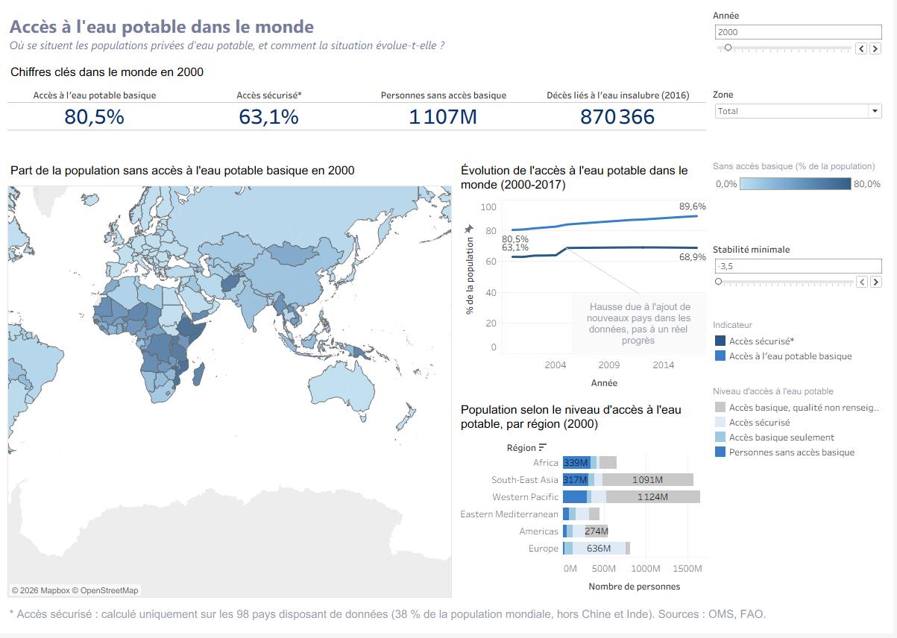
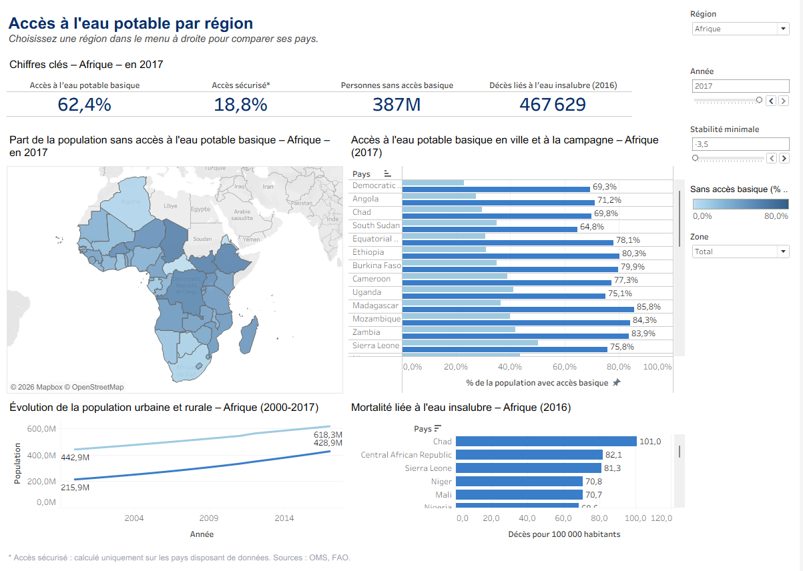
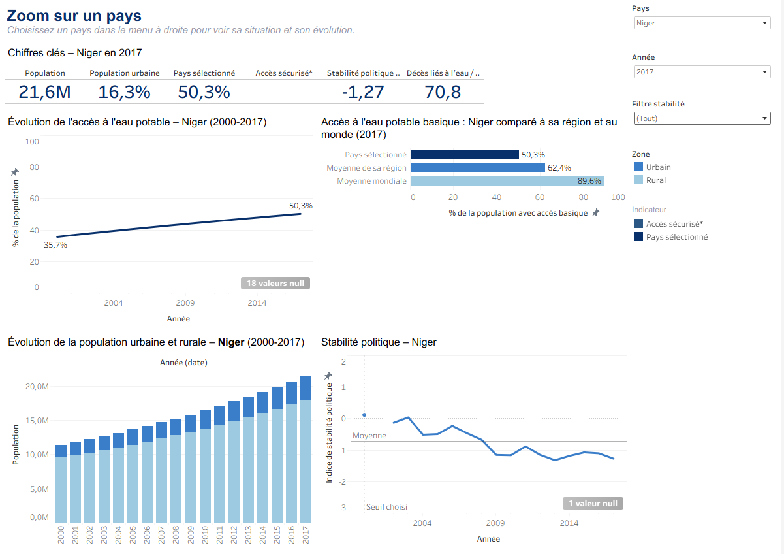
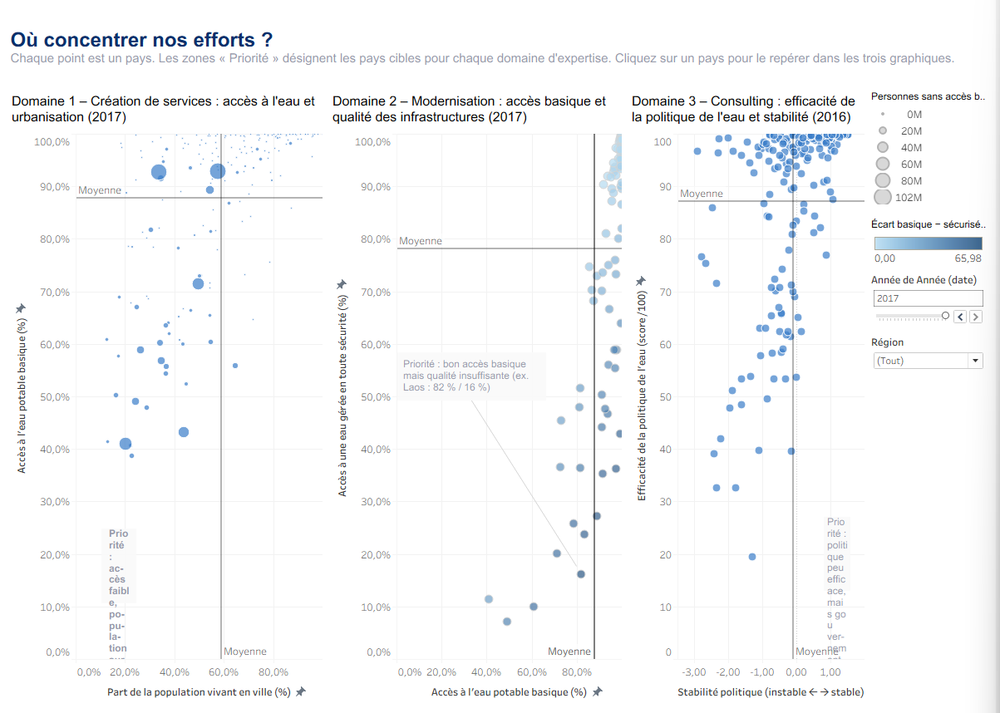
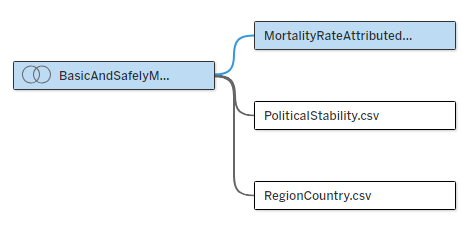
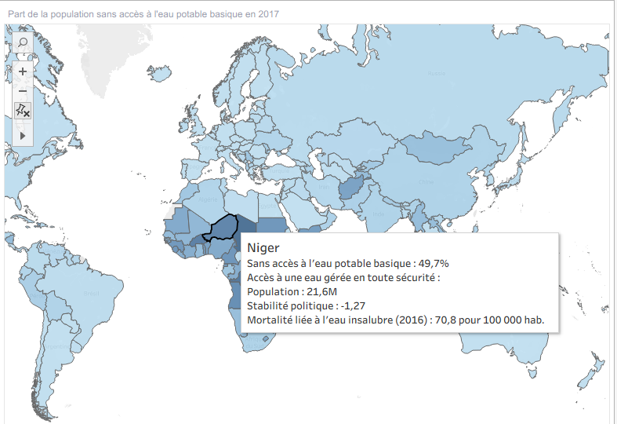

# Accès à l'eau potable dans le monde – Tableau de bord Tableau

Tableau de bord interactif réalisé sous **Tableau** pour aider une ONG (fictive) à repérer les pays qui manquent d'eau potable et à choisir où investir.

**Voir le tableau de bord sur Tableau Public :**
[Accès à l'eau potable dans le monde – DWFA](https://public.tableau.com/app/profile/amine.nakrou/viz/AccsleaupotabledanslemondeDWFA/HistoireDWFA)



## Contexte

Projet de groupe réalisé dans le cadre du cours de Data visualisation à Polytech Lille (ISIA 5).

Mise en situation : nous sommes consultants data analysts pour l'ONG *Drinking Water For All* (DWFA). L'ONG demande un financement pour investir dans **un seul** de ses trois domaines d'expertise, dans un pays encore à choisir :

| Domaine | Objectif |
|---|---|
| 1. Création | Créer des services d'accès à l'eau là où ils manquent |
| 2. Modernisation | Améliorer des services existants mais de mauvaise qualité |
| 3. Consulting | Conseiller les gouvernements sur leur politique de l'eau |

**Question :** quels pays ont des difficultés d'accès à l'eau potable, et où concentrer les efforts pour chaque domaine ?

## Le livrable : une histoire Tableau en 4 tableaux de bord

| Vue | Contenu |
|---|---|
| Vue mondiale | Chiffres clés, carte, évolution 2000-2017, population par niveau d'accès et par région |
| Vue continentale | Carte de la région, accès urbain / rural par pays, mortalité, évolution de la population |
| Vue nationale | Fiche d'un pays : évolution de l'accès, comparaison région / monde, population, stabilité politique |
| Où investir ? | Un nuage de points par domaine d'expertise, avec un seuil de stabilité réglable |

<table>
<tr>
<td></td>
<td></td>
</tr>
<tr>
<td align="center">Vue continentale (Afrique, 2017)</td>
<td align="center">Vue nationale (Niger, 2017)</td>
</tr>
</table>



## Les données

Cinq fichiers CSV publics, dans [`data/`](data) :

| Fichier | Source | Contenu | Niveau de détail | Période |
|---|---|---|---|---|
| `BasicAndSafelyManagedDrinkingWaterServices.csv` | OMS | % de la population avec un accès basique / sécurisé | pays × année × zone | 2000-2017 |
| `Population.csv` | FAO | Population en milliers | pays × année × zone ou sexe | 2000-2018 |
| `PoliticalStability.csv` | FAO | Indice de stabilité politique | pays × année | 2000-2018 (sauf 2001) |
| `MortalityRateAttributedToWater.csv` | OMS | Mortalité liée à l'eau insalubre (WASH) | pays × sexe | 2016 |
| `RegionCountry.csv` | OMS | Région OMS de chaque pays | pays | – |

## Préparation des données

**Modèle de données**

- Jointure gauche **Eau + Population** sur Pays, Année et Zone (même niveau de détail). Résultat : 10 476 lignes, autant que le fichier eau, donc pas de doublon.
- **Relations** (et non jointures) vers la stabilité, la mortalité et les régions. Ces tables ont un autre niveau de détail : une jointure aurait répété la stabilité pour chaque zone et faussé les sommes.



**Nettoyage**

- Noms de pays différents entre OMS et FAO : « China » relié à « China, mainland », et l'agrégat FAO (avec Hong Kong, Macao, Taïwan) écarté pour ne pas compter ces territoires deux fois ; « North Macedonia » aligné sur le nom OMS.
- Population convertie en personnes (× 1 000).
- Taux mondiaux et régionaux **pondérés par la population**.

**Champs calculés principaux**

| Champ | Formule |
|---|---|
| Accès basique pondéré | `SUM(taux × population) / SUM(population renseignée)` |
| Personnes sans accès | `(1 − accès basique / 100) × population` |
| Taux d'urbanisation | `{FIXED [Pays], [Année] : pop. urbaine} / pop. totale` |
| Écart basique − sécurisé | `accès basique − accès sécurisé` |
| Score d'efficacité (0-100) | `0,5 × accès basique + 50 × (1 − mortalité / mortalité max)` |
| Filtre stabilité | `stabilité ≥ [Stabilité minimale]` (paramètre de −3,5 à 2) |

## Conception et accessibilité

- Palette « Bleu » à une seule teinte, lisible par les personnes daltoniennes, avec des bleus assombris pour le contraste.
- La couleur ne porte jamais seule l'information : étiquettes, tailles et infobulles en français.
- Titres dynamiques (année, région, pays choisis) et échelle de couleur fixe (0-80 %) pour comparer les années.
- Limites des données écrites directement sur les graphiques.



## Résultats clés

- **776 millions** de personnes sans accès basique à l'eau potable en 2017 (1,1 milliard en 2000). L'accès basique passe de 80,5 % à 89,6 % de la population mondiale.
- **L'Afrique** concentre la moitié de ce besoin : 387 M de personnes, 62,4 % d'accès basique, 18,8 % d'accès sécurisé.
- **Fort écart ville / campagne** : en RD Congo, 22,8 % d'accès en zone rurale contre 69,3 % en ville. La population rurale africaine passe de 443 M à 618 M entre 2000 et 2017.

**Pays repérés par domaine**

| Domaine | Critère | Pays |
|---|---|---|
| Création (2017) | Accès faible, population rurale | Éthiopie, Ouganda, Madagascar |
| Modernisation (2017) | Bon accès basique, faible accès sécurisé | Laos, Népal, Mongolie |
| Consulting (2016) | Score d'efficacité faible, pays stable | Bénin, Zambie, Comores |

Ce sont des pistes : le seuil de stabilité est réglable dans le tableau de bord, et la liste change avec lui.

## Vérification des chiffres

Les chiffres clés ont été recalculés hors de Tableau, avec pandas, en reproduisant le même modèle de données :

```bash
pip install -r requirements.txt
python scripts/verifier_chiffres.py
```

Le script ([`scripts/verifier_chiffres.py`](scripts/verifier_chiffres.py)) retrouve les valeurs affichées dans Tableau : 89,6 % d'accès basique et 776 M de personnes sans accès en 2017, 387 M en Afrique, les scores du domaine 3, etc.

## Limites

- Données de 2016 à 2018 : la situation a pu évoluer depuis.
- Accès sécurisé renseigné pour 98 pays seulement (38 % de la population mondiale, sans la Chine ni l'Inde).
- Mortalité disponible pour 2016 uniquement.
- Pas de densité de population, faute de superficie dans les données.

## Structure du dépôt

```
├── data/                    # 5 fichiers CSV (OMS, FAO)
├── images/                  # captures des tableaux de bord
├── scripts/
│   └── verifier_chiffres.py # recalcul des chiffres clés avec pandas
├── requirements.txt
└── README.md
```

## Outils

Tableau Public · Python (pandas)

## Équipe

- Aymen Khatrani
- Hajar Mahmoudi
- Amine Nakrou

---

### English summary

Interactive **Tableau** dashboard on access to drinking water worldwide (WHO and FAO data, 2000-2017). It identifies the countries with the poorest access and suggests where a (fictional) NGO should invest in each of its three fields: building new water services, upgrading existing ones, or advising governments. The work includes data modelling (a join plus relationships), data cleaning, population-weighted indicators, LOD calculations, an accessible colour palette, and a Python script that cross-checks the key figures. [View it on Tableau Public](https://public.tableau.com/app/profile/amine.nakrou/viz/AccsleaupotabledanslemondeDWFA/HistoireDWFA).
